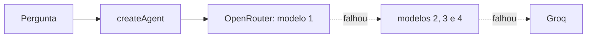

# 🔀 Agente com OpenRouter e fallback

> O menor exemplo funcional de um agente de IA em Node.js com **vários modelos em cascata**: se o principal falhar, o OpenRouter tenta o próximo e, por fim, o Groq.


## Ideia

Modelos gratuitos caem e têm limite. Este projeto mostra como manter o agente no ar:

1. **OpenRouter** com `route: "fallback"`: um modelo principal e três reservas (`OPENROUTER_MODELO_1` a `4`).
2. **`modelFallbackMiddleware`** do LangChain: se tudo no OpenRouter falhar, usa o **Groq** (`openai/gpt-oss-120b`).



## Endpoints

| Método | Rota | Descrição |
|---|---|---|
| `POST` | `/conversa` | `{ "pergunta": "..." }` → `{ "Resposta": "..." }` |
| `GET` | `/conversa/historico` | histórico da execução atual |

## Como rodar

```bash
git clone https://github.com/joseaugustodearaujoaraujo1-lgtm/agent_com_openrouter.git
cd agent_com_openrouter
npm install
cp .env.example .env   # API_ROUTER, API_GROQ e OPENROUTER_MODELO_1..4
node main.js           # http://localhost:3001
```

## Limitações

- Cada pergunta é enviada ao agente **sem o histórico anterior**; o histórico só é guardado em memória para consulta.
- Sem autenticação nem testes. É um exemplo didático.

Evoluções deste exemplo: [tavily_openrouter](https://github.com/joseaugustodearaujoaraujo1-lgtm/tavily_openrouter) (com busca na web) e [agent_MCP_email](https://github.com/joseaugustodearaujoaraujo1-lgtm/agent_MCP_email) (com MCP).
